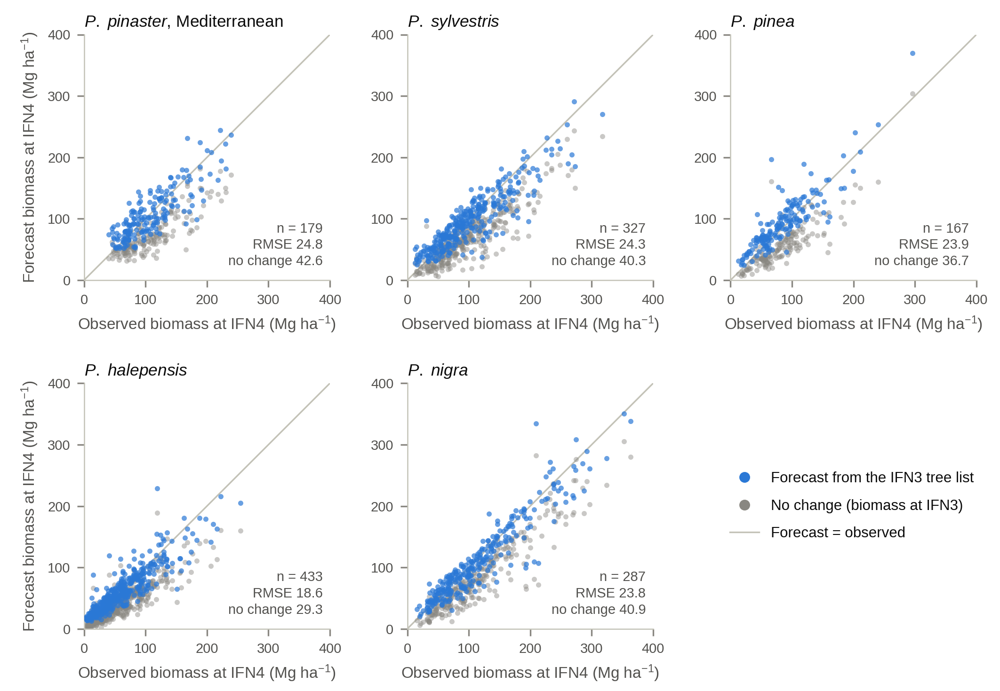

# Iberian pines: validation with Spanish forest inventories

**Code, plot-level forecasts, and figures for evaluating biomass forecasts across regions.**

This repository accompanies the manuscript *Regional transfer and inventory-anchored biomass forecasts for Iberian pines: validation with repeated Spanish forest inventories*, by Alberto Albiol, Miquel Obrador-Reina, Juan B. Pedro, and Albert Fernández.

**Publication status:** The manuscript is currently under revision. A link to the published article and its full citation will be added here after publication.

**Released asset:** [GitHub v1.0.0](https://github.com/alalbiol/iberian-pines-ifn-validation/releases/tag/v1.0.0) corresponds to **[EOTDL dataset version 1](https://www.eotdl.com/datasets/iberian-pines-ifn-validation)**. The exact source commit is `dc6d77f407f4e0273e15fac18acf86791cded1a6`. All 115 uploaded payload files were verified against this commit. See [the release record](provenance/releases/v1.0.0.json) for the dataset ID and manifest checksum.


We test two different forecasting situations using Spain’s National Forest Inventory (IFN): predicting biomass when only stand age and species are known, and forecasting the next inventory from a measured tree list. Model components are fitted in designated provinces and evaluated in other provinces.



## What the study covers

Five species are represented: *Pinus pinaster* (separate Atlantic and Mediterranean cases), *P. sylvestris*, *P. pinea*, *P. halepensis*, and *P. nigra*.

| Evaluation | Starting information | Reference | Distributed test plots |
|---|---|---|---:|
| Age-only | Species, stand age, default site quality and density | IFN standing biomass | 364 across six cases |
| Measured-tree forecast | IFN3 tree list | IFN4 standing biomass | 1,393 across five cases |

Atlantic *P. pinaster* is included in the age-only evaluation; the five measured-tree cases comprise Mediterranean *P. pinaster* and the four other species.

Forecasts from measured trees reduce RMSE from approximately 29–43 to 19–25 Mg ha⁻¹ compared with assuming no biomass change. Age-only forecasts transfer much less consistently. Inventory biomass is calculated using allometric equations: these comparisons evaluate the growth and aggregation chain, not an independent measurement of the allometry itself. The study does not validate planting-to-harvest trajectories.

## Quick start: reproduce metrics and figures

The plot-level forecast tables are included. This route requires no inventory download, credentials, or access to the original project repository.

Use Python 3.11 (tested with 3.11.15) and install the pinned direct dependencies:

```bash
python -m venv .venv
source .venv/bin/activate
python -m pip install -r requirements-lock.txt

python scripts/reproduce.py
```

The reproduction command recomputes sample sizes, RMSE, bias, and MAE, checks them against the supplied reference metrics, and regenerates all four manuscript figures as PDF and PNG. Metrics and a verification report are written to `outputs/`; figures are written to `analysis/figures/`. Bias is prediction minus reference. The map data are included. This descriptive check does not regenerate the manuscript’s bootstrap confidence intervals. Use `--metrics-only` to skip plotting.

## Repository guide

The `analysis/` directory contains the evaluation code, derived results, and figure-generation tools. Shared growth-model and inventory modules are in `models/`.

```text
analysis/     Evaluation scripts, derived results, and figures
models/       Growth equations, fitted parameters, and inventory readers
scripts/      Download, reproduction, and release tools
expected/     Reference metrics used by the reproduction check
provenance/   Input sources, checksums, and verification records
tests/        Downloader tests
```

| Path | Contents |
|---|---|
| [`results/plot_level/`](analysis/results/plot_level/) | Held-out forecasts used in the figures and quick-start metrics |
| [`results/`](analysis/results/) | Saved evaluation outputs, fitted-component diagnostics, and historical audit notes |
| [`analysis scripts`](analysis/) | Inventory screening, model fitting, evaluation, and plot-level export |
| [`model and inventory modules`](models/) | Growth models, biomass equations, inventory readers, and tree matching |
| [`figure code`](analysis/figures/make_figures.py) | Manuscript figures from distributed forecasts |
| [`DATA.md`](DATA.md) | Data sources, file layout, and column definitions |
| [`REPRODUCING.md`](REPRODUCING.md) | Regeneration from the original inventory databases |
| [`source snapshot`](provenance/source_snapshot.json) | Source commit, file hashes, and portability changes |

Historical results include earlier screens and exploratory climate analyses. Their sample counts need not match the final figure inputs. For the current plotted evaluation, use `results/plot_level/`; for details of a particular sensitivity analysis, consult its corresponding script and JSON output.

## Data and reproducibility

The original inventory databases are provided by [MITECO: IFN3](https://www.miteco.gob.es/es/biodiversidad/servicios/banco-datos-naturaleza/informacion-disponible/ifn3_bbdd_descargas_htm.html) and [MITECO: IFN4](https://www.miteco.gob.es/es/biodiversidad/temas/inventarios-nacionales/inventario-forestal-nacional/cuarto_inventario.html). They are not redistributed here. The repository includes derived forecasts and the code needed to read the downloaded databases.

To download the original databases automatically (Python standard library only):

```bash
export IFN_DATA_ROOT="$HOME/ifn-data"
python scripts/download_inventories.py
```

The downloader retrieves and extracts **42 databases**: 19 IFN4 files covering 23 provinces, plus the corresponding 23 IFN3 files. It checks every database against the study’s recorded SHA-256 hash, skips existing verified files, and refuses changed files. The databases occupy about **552 MB**, plus space for cached ZIP archives (about 735 MB total in the verified download). This download is optional for reproducing the metrics and figures from the small distributed forecast tables.

Use `--list` to inspect sources, or `--verify-only` to check files already present. The full inventory-analysis workflow additionally needs `mdbtools`; see [REPRODUCING.md](REPRODUCING.md). `MDB_EXPORT` can override the `mdb-export` executable.

Release v1.0.0 is available as EOTDL dataset version 1. The provenance file records the original project snapshot and per-file hashes. Neither a publication DOI nor a repository archive DOI has been assigned here.

## Citation and reuse

When referring to these materials, identify this repository and the exact commit or archived release used. Publication and archival citation metadata will be added when available.

The code and associated software documentation are licensed under the [MIT License](LICENSE). You may use, modify, and redistribute them, including commercially, provided you retain the copyright and licence notice.

The derived CSV/JSON data and research figures are licensed under [Creative Commons Attribution 4.0 International](LICENSE-DATA), with attribution to the four authors listed above and this repository. Indicate changes when redistributing adapted materials. The EOTDL `license` metadata describes this dataset licence; code and software documentation remain MIT. Original MITECO data retain their source terms; the Natural Earth boundary data used in the figures are public domain.

## Acknowledgements

This work was carried out within **AI4DIS**, “Industrialization of AI Methods for Decision Intelligence in Climate and Security Applications”, funded by the European Space Agency under Contract No. **4000147555/25/I-DT**. The Universitat Politècnica de València participated as a subcontractor to EarthPulse S.L., the prime contractor. The views expressed are those of the authors and do not necessarily reflect the official position of the European Space Agency.

We thank MITECO for making the National Forest Inventory databases publicly available.

## EOTDL distribution

See [EOTDL.md](EOTDL.md) for building the upload folder and publishing it. The upload contains the code snapshot, derived data, reference metrics, figures, documentation, and inventory downloader. EOTDL ingests this as a folder of files; no ZIP wrapper is required. Raw inventory databases are downloaded separately from MITECO and are not bundled in the EOTDL asset.
